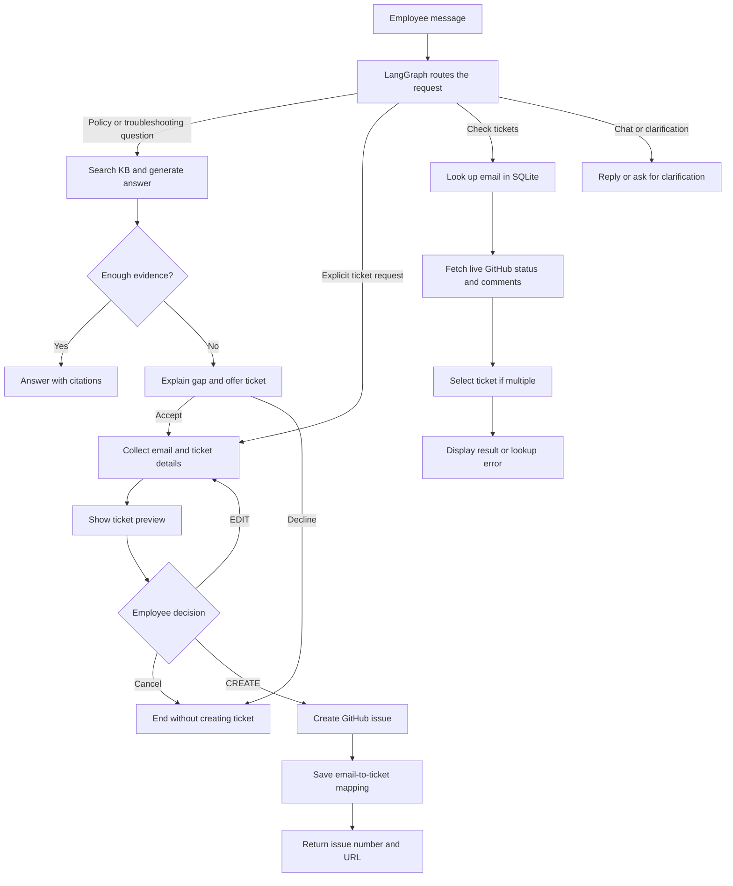
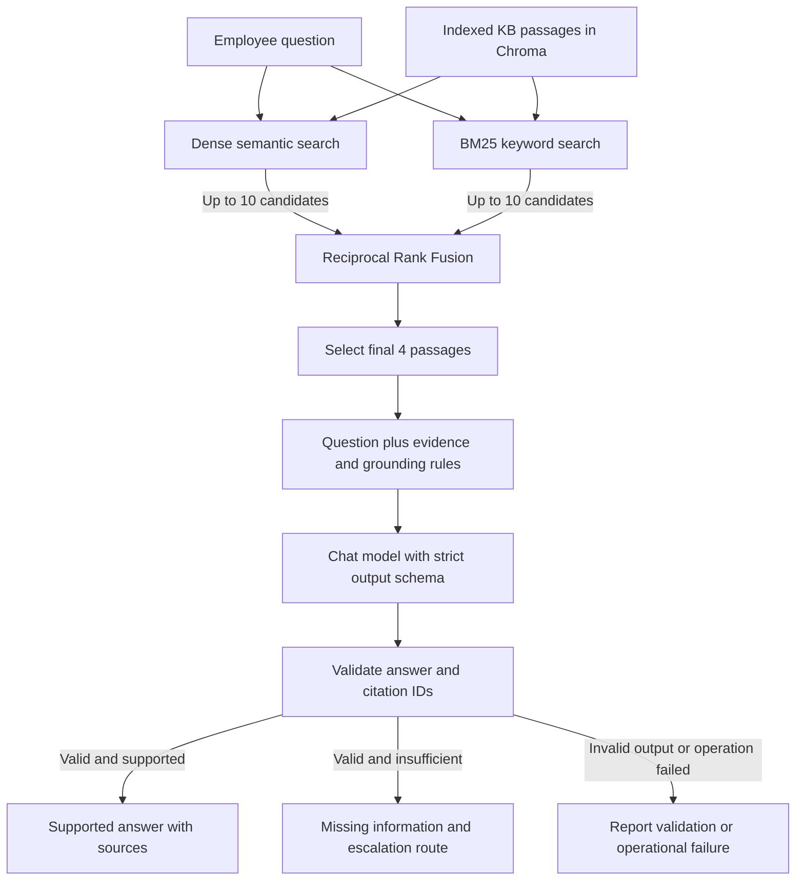
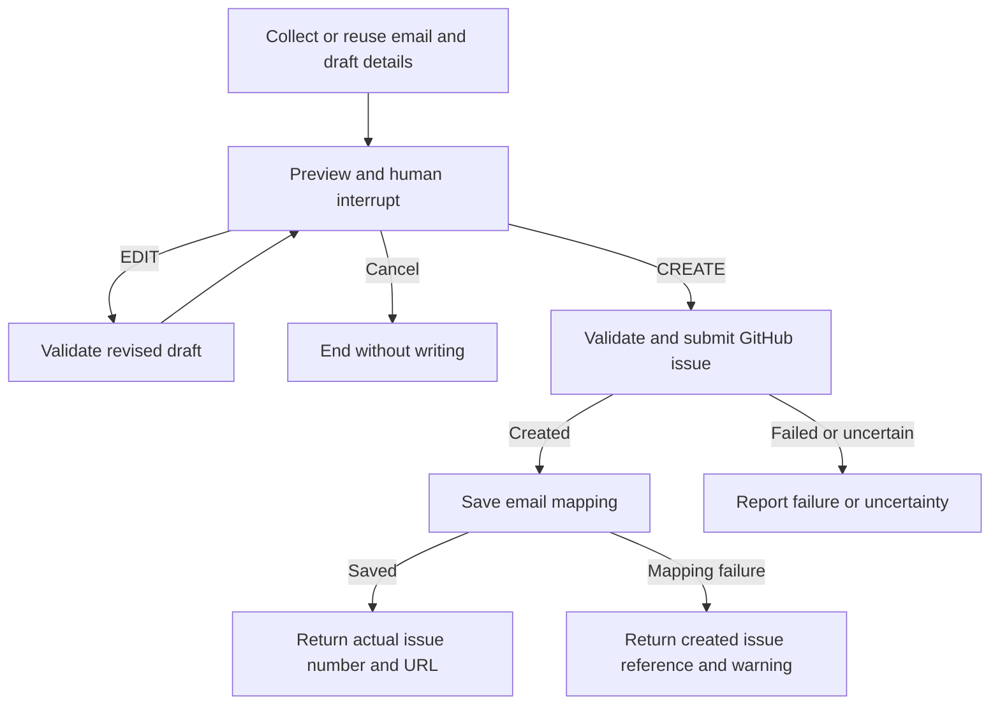

# SmartDesk AI

A conversational IT and HR helpdesk for fictional **NovaTech Solutions**. SmartDesk answers from a reviewed knowledge base, offers escalation when requested information is missing, creates real GitHub Issues after explicit confirmation, and reads live ticket status and support comments.

The application runs locally through a CLI. LangGraph coordinates conversation state and human input; LangChain supplies the RAG prompt and model interfaces.

## Implementation status

| Component | Implemented behavior |
|---|---|
| Knowledge base | 30 reviewed Markdown documents across IT, HR, onboarding and payroll |
| Preparation | Markdown section splitting, metadata preservation and 179 generated chunks |
| Dense retrieval | OpenAI embeddings with persistent Chroma |
| Sparse retrieval | BM25 over the same indexed passages |
| Hybrid retrieval | Dense and BM25 candidates combined with Reciprocal Rank Fusion (RRF) |
| Answer generation | Evidence-grounded structured response; request-specific allowed citation IDs |
| Conversation | Intent routing, follow-up resolution, session email memory and session reset |
| Ticket creation | Email and draft collection, preview, editing, cancellation and explicit `CREATE` confirmation |
| Ticket status | Local email mapping, live GitHub state/comments and multiple-ticket selection |
| Error handling | Operational errors distinguished from missing KB evidence; no automatic ticket-write retry |

The working implementation is in `scripts/`. A `src/smartdesk/` package and a single ingestion wrapper are possible future refactors, not required components of the current application.

## Latest reported validation

Results below come from the NUC run shared on November 5, 2026, using `k=4`, 23 development cases and the expanded 179-chunk index.

| Metric | Dense | Hybrid |
|---|---:|---:|
| Completed cases | 23/23 | 23/23 |
| Cases retrieving every expected chunk | 22/23 | 23/23 |
| Correct answerability decision | 23/23 | 23/23 |
| Valid citation IDs | 23/23 | 23/23 |

All **22 offline workflow/API/storage tests passed** in the same reported validation sequence. Manual CLI demonstrations also showed KB answers, confirmed GitHub ticket creation, and live status/comments retrieved after restarting the CLI.

Dense missed the designated tax-deadline passage in this run, while still reporting insufficient evidence. Earlier runs showed other intermittent retrieval and decision differences. Their cause has not been established. The latest scores do not establish repeatability, general accuracy, or a statistically meaningful advantage for hybrid retrieval. Hybrid is the selected demonstration mode.

These are development cases used during implementation, not a held-out test set. Citation-ID validity checks membership in the retrieved evidence, not whether every claim follows from its citation. `expected_answer` is saved for manual review and is not automatically graded for meaning.

## Requirements and configuration

- Python and a dedicated virtual environment. Use the same Python minor version as the working environment for the first clean-install check; record it with `python --version`.
- OpenAI API credentials and network access for embeddings, routing and generation.
- A GitHub repository with Issues enabled and a fine-grained token granting that repository **Issues: read and write** access, plus required read-only metadata access.
- Current ticket destination: [`mith1979/smartdesk-tickets`](https://github.com/mith1979/smartdesk-tickets).

That repository stores demonstration support issues. It is not evidence that the SmartDesk application source repository has been published.

The current ticket implementation restricts operations to this repository. Changing destinations requires updating `EXPECTED_REPOSITORY` in `scripts/verify_github.py` and `REPOSITORY` in `scripts/ticket_store.py`, as well as configuration.

| Variable | Purpose |
|---|---|
| `OPENAI_API_KEY` | Query/document embeddings, intent routing and answer generation |
| `OPENAI_CHAT_MODEL` | Optional chat model override; current default is `gpt-4o-mini` |
| `GITHUB_TOKEN` | Token scoped to the ticket repository |
| `GITHUB_REPOSITORY` | `mith1979/smartdesk-tickets` |
| `HF_TOKEN` | Optional authentication for dataset downloads |

Configuration precedence is existing process variables, then project `.env`, then shared `fde_program/.env`, all loaded without overriding earlier values. Blank project values can mask populated shared values. Keep a working installation's configuration intact; never commit real credentials.

**Portability limitation:** the current shared `.env` fallback uses the FDE directory layout. A sufficiently shallow checkout path can fail at import when ancestor paths are calculated. A project `.env` alone cannot fix an import-time path calculation. Review those constants before claiming arbitrary-location clone/install support. Fresh-checkout verification remains pending.

## Setup

Run from the project root. On the existing NUC, activate the dedicated environment:

```bash
cd ~/projects/python/fde_program/notebooks/week_11/smartdesk_capstone
source .venv-smartdesk/bin/activate
```

For a new installation, after checking the path limitation above:

```bash
python3 -m venv .venv-smartdesk
source .venv-smartdesk/bin/activate
python -m pip install -r requirements.txt
python -m pip check
```

Create a project `.env` from `.env.example` only if one does not already exist, fill its values locally, and use `chmod 600 .env`. The existing NUC may continue using its working shared configuration. Do not overwrite it with placeholder values.

The user generated `requirements.txt` with `python -m pip freeze` from the dedicated environment and reported no broken requirements. Dependency consistency in that environment is verified; installation from scratch using that file is not yet verified. Check the final file for machine-specific paths before publishing.

### Verify a fresh clone

Publishing the application source to GitHub and verifying installation are separate steps. After publishing, clone the repository into a separate directory, create a new virtual environment, install `requirements.txt`, and configure credentials locally using `.env.example`. Rebuild the chunks and Chroma index from the committed `data/kb/` files, run the offline workflow tests, and perform a conversational smoke test. Do not copy the working environment, generated index, or private ticket-mapping database into the fresh clone.

A successful push does not establish that the project installs or runs from scratch. This check has not yet been completed; the environment-path limitation above must be addressed as part of it.


## Data and provenance

| Location | Role |
|---|---|
| `data/raw/hr_train.jsonl` | Original downloaded HR snapshot: 644 records |
| `data/raw/it_train.jsonl` | Original downloaded IT ticket snapshot: 500 records |
| `data/raw/hr_candidates.json` | 11 selected HR candidate records for review |
| `data/raw/synthetic/kb_expansion/` | Staged synthetic expansion drafts retained for provenance |
| `data/kb/` | Reviewed Markdown source of truth used to build RAG evidence |
| `data/processed/chunks.jsonl` | Generated section text and metadata |
| `storage/chroma/` | Generated persistent vector index |
| `data/evaluation/` | Development cases and saved result reports |
| `storage/tickets.sqlite3` | Persistent local email-to-ticket mapping; exclude from Git |

Downloaded sources:

- [`strova-ai/hr-policies-qa-dataset`](https://huggingface.co/datasets/strova-ai/hr-policies-qa-dataset): HR conversations adapted into selected fictional policy guides.
- [`Console-AI/IT-helpdesk-synthetic-tickets`](https://huggingface.co/datasets/Console-AI/IT-helpdesk-synthetic-tickets): ticket topics used as inspiration. This snapshot has **no resolution field**; invented demonstration procedures are not verified historical resolutions.

The final KB has **26 synthetic documents and 4 dataset-adapted HR documents**. Two of the synthetic IT guides are ticket-inspired. Domain counts: HR 10, IT 11, onboarding 5 and payroll 4. Source adaptation does not establish the original material as verified real-world company policy. All NovaTech policies, contacts and portal addresses are demonstration content.

HR adaptation mapping: `policy_updates.md` uses source records 1, 2, 5 and 251; `compliance_contacts.md` uses 8, 9, 229 and 433; `reporting_concerns.md` uses 282; `confidentiality.md` uses 605. These numbers refer to the local downloaded snapshot.

## Build or update the index

Reviewed KB files contain flat frontmatter metadata and Markdown `##` sections. After reviewing changes, run:

```bash
python scripts/inspect_kb.py
python scripts/build_chunks.py
python scripts/inspect_chunks.py
python scripts/load_documents.py
python scripts/build_index.py
```

Current expected output: **30 documents, 179 chunks and 179 indexed entries**. `load_documents.py` is an inspection entry point; `build_index.py` also uses the document-loading function.

The chunker splits at level-two headings and repeats the shared document introduction in each passage. This is Markdown structure-aware section splitting, not recursive or embedding-based semantic splitting. The processed JSONL becomes LangChain Documents with text in `page_content` and provenance/source fields in `metadata`. Do not also ingest the original Markdown as duplicate runtime evidence.

Embedding model: `text-embedding-3-small`. Chroma collection: `smartdesk_sections_openai_small_v1`. Storage: `storage/chroma/`.

Indexing incurs embedding API usage. Stable chunk IDs support upserts, but do not automatically remove stale entries when documents are deleted or sections renumbered. Reconcile stale entries or rebuild an isolated index when IDs change; do not remove the entire `storage/` directory, which also contains ticket mappings.

The expansion drafts have already been promoted on the NUC. Do not rerun `promote_kb_expansion.py --approve` on that installation: it deliberately refuses existing target files. A fresh installation uses the reviewed `data/kb/` documents directly.

## Run SmartDesk

```bash
python scripts/smartdesk_chat.py --retrieval hybrid
```

Add `--debug` to inspect model intent, effective intent, context resolution and retrieved IDs. Use `--retrieval dense` for the baseline.

- `/new` starts a new thread and clears remembered email/chat context.
- `/quit` exits the process.
- `/cancel` stops supported email-collection and ticket-selection prompts.
- At the ticket preview, `EDIT` revises the draft and requires a new preview/approval. Exact `CREATE` submits; other approval input cancels.

`InMemorySaver` stores conversation checkpoints only during the running process. SQLite mappings survive process restart; conversation history and remembered email do not. An email is a capstone lookup identifier, not authenticated employee identity.

For a single-turn RAG check without ticket orchestration:

```bash
python scripts/rag.py "I joined in July. How much sick leave do I receive that year?" --retrieval hybrid
```

`rag.py` does not submit tickets. Use `smartdesk_chat.py` for the integrated workflow. An old standalone message saying ticket creation is not connected is obsolete wording, not a description of the integrated application.

## Architecture

### Complete conversation flow



This is the successful-path overview. No associated tickets produces an explicit
no-match response. Operational failures are reported separately from missing KB
information. The creation failure boundaries are shown below.

### Hybrid RAG flow



Candidate counts in this diagram use the evaluation settings: `k=4` and
`fetch_k=10`. Dense-only mode bypasses BM25 and RRF. Passage embeddings are
created during indexing; the query embedding is created at search time.

### Ticket approval and failure boundaries



### Two kinds of memory

| Memory | Stores | Survives CLI restart? |
|---|---|---|
| LangGraph `InMemorySaver` | Conversation context, supplied email and workflow state | No |
| SQLite | Employee email-to-GitHub-ticket associations | Yes |

LangGraph coordinates the conversation. RAG supplies evidence-based answers.
GitHub owns the tickets and their current state. SQLite remembers the email
associations, not a cached ticket status.

Mermaid blocks require a Markdown viewer with Mermaid support. In a plain-text
editor, their diagram source will be visible instead of a rendered picture.

`interrupt()` pauses for human input; the CLI resumes using `Command(resume=...)` and the same thread ID. Issue creation occurs after approval in a separate node. The state machine supports cancellation and editing before a write.

Dense search embeds the question through the Chroma embedding function. BM25 uses the same stored passage texts, simple lowercase tokenization, stable corpus order and deterministic score ties. Hybrid fetches up to `max(10, k)` candidates per method and adds `1 / (60 + rank)` contributions per chunk before returning the final `k` passages. RRF combines ranks, not raw scores. No learned semantic reranker is implemented.

The answer model returns `answer`, `source_ids` and `evidence_status`. A fresh strict JSON schema restricts `source_ids` to the retrieved IDs for that request; the result is converted back to `RagAnswer`. Python derives `answerable` from `evidence_status == "supported"`. Supported negative answers are valid answers; an undefined procedure plus a referral remains insufficient. The model still makes the sufficiency decision.

See `architecture.txt` for node-level behavior, the full KB inventory and worked examples.

## External ticket tools

```bash
python scripts/verify_github.py
python scripts/tickets.py status --email employee@example.com
```

`tickets.py` provides reusable creation and employee-ticket lookup functions. It uses `verify_github.py`, `check_ticket.py` and `ticket_store.py`; keep these modules together. The graph collects email, summary, description and category, validates them, and submits only after confirmation. Category is stored in the GitHub issue body, not a GitHub label.

Status requests use SQLite to locate associated issue numbers and GitHub to retrieve current state and comments. The implementation fetches associated ticket details/comments before presenting multiple-ticket selection. It shows GitHub `open`/`closed` states, not an invented in-progress state. Tickets without a local email association are not discovered by this lookup.

Ticket writes have no automatic retry. A write timeout can mean the issue was created but its response was lost; inspect GitHub before resubmission. If creation succeeds but mapping fails, retain the returned issue reference and repair the mapping rather than recreating the issue. Partial comment-fetch failures should retain the available live ticket state and report the missing comments.

## Tests and evaluation

Offline workflow checks:

```bash
python tests/test_workflow.py
```

The 22 tests mock model/API responses and cover approval, edits, cancellation, follow-up handling, session isolation, citation rejection, operational failures, uncertain writes, partial failures and mapping integrity. They do not exercise live model judgments or prove end-to-end grounding. Report: `data/evaluation/workflow_results.json`.

Live RAG development evaluation:

```bash
python scripts/evaluate_rag.py --retrieval dense --k 4
python scripts/evaluate_rag.py --retrieval hybrid --k 4
```

Input: `data/evaluation/rag_cases.json`, containing the original nine cases plus fourteen KB-expansion cases. Outputs: `data/evaluation/dense_results.json` and `data/evaluation/hybrid_results.json`. These calls incur API usage and overwrite the mode-specific report. They evaluate RAG directly, not conversational routing.

- Required-evidence coverage: expected chunk IDs retrieved divided by expected IDs.
- All-required-evidence cases: cases where that coverage equals 100%.
- Answerability: predicted Boolean agrees with the expected Boolean.
- Citation validity: cited IDs belong to retrieved evidence, with a nonempty citation list for a supported answer.

Manually compare generated answers with the KB and `expected_answer`. A response can pass all three checks while overstating policy or giving a misleading opening answer. Do not change expected outcomes to conceal failures or describe a passing rerun as proof that earlier failures are fixed.

## Evaluation run excerpts

The following excerpts are copied from the latest terminal results supplied by
the project author on November 5, 2026. Only selected case lines and the summary
are reproduced; omitted lines are not additional test results. These commands
were not rerun while writing this README.

### Dense RAG

Command:

```bash
python scripts/evaluate_rag.py --retrieval dense --k 4
```

Selected output:

```text
mfa-recovery: evidence=100% | decision=PASS | citations=PASS
monitor-replacement-unknown: evidence=100% | decision=PASS | citations=PASS
guest-wifi-renewal: evidence=100% | decision=PASS | citations=PASS
tax-universal-deadline-unknown: evidence=0% | decision=PASS | citations=PASS

Completed: 23/23
All required evidence: 22/23
Correct answerability: 23/23
Valid citations: 23/23
Saved: /home/mithun/projects/python/fde_program/notebooks/week_11/smartdesk_capstone/data/evaluation/dense_results.json
```

Interpretation: every case completed, all decision and citation-ID checks passed,
but the designated tax-deadline evidence was not retrieved. The correct
insufficient-evidence decision does not turn that retrieval check into a pass.

### Hybrid RAG

Command:

```bash
python scripts/evaluate_rag.py --retrieval hybrid --k 4
```

Selected output:

```text
mfa-recovery: evidence=100% | decision=PASS | citations=PASS
monitor-replacement-unknown: evidence=100% | decision=PASS | citations=PASS
guest-wifi-renewal: evidence=100% | decision=PASS | citations=PASS
tax-universal-deadline-unknown: evidence=100% | decision=PASS | citations=PASS

Completed: 23/23
All required evidence: 23/23
Correct answerability: 23/23
Valid citations: 23/23
Saved: /home/mithun/projects/python/fde_program/notebooks/week_11/smartdesk_capstone/data/evaluation/hybrid_results.json
```

Interpretation: all three measured checks passed for all 23 development cases
in this run. This is not an automatic factual-correctness or faithfulness score.

### Offline workflow suite

Command:

```bash
python tests/test_workflow.py
```

Selected test lines and summary:

```text
test_creation_requires_confirmation (__main__.TicketApiTests.test_creation_requires_confirmation) ... ok
test_cancellation_never_calls_ticket_creation (__main__.WorkflowTests.test_cancellation_never_calls_ticket_creation) ... ok
test_invalid_citation_rejects_generated_answer (__main__.WorkflowTests.test_invalid_citation_rejects_generated_answer) ... ok
test_new_session_does_not_inherit_email (__main__.WorkflowTests.test_new_session_does_not_inherit_email) ... ok

Ran 22 tests in 0.161s

OK

Saved: /home/mithun/projects/python/fde_program/notebooks/week_11/smartdesk_capstone/data/evaluation/workflow_results.json
```

Interpretation: the mocked workflow/API/storage suite passed. Live GitHub
integration and conversational behavior were checked separately through the
manual flows below. The 0.161-second runtime belongs to the offline tests,
not the live RAG or GitHub calls.

## Demonstration plan

1. **KB answer:** ask how to reset a password. Inspect the documented steps and citation. Ask the July sick-leave question (4 days) and September follow-up (3 days after rounding up to the nearest half-day).
2. **Escalation/write:** ask how to replace a flickering monitor. The procedure and eligibility are deliberately undefined. Accept drafting, supply a fictional employee email, inspect/edit the preview and submit with `CREATE`. Show the actual GitHub issue and URL. Demonstrate a separate cancellation with no write.
3. **Status/read:** ask for ticket updates, selecting among multiple tickets if necessary. Manually add a demonstration support comment on GitHub and ask again. Show the new comment. Restart the CLI, provide the same email, and show that mapping persists while conversational email memory resets.

Also demonstrate `/new` with an unmapped email. No local association should be reported clearly; an API error must not be misreported as no tickets. Use fictional data in recordings and debug logs.

## FDE concept connection

Weeks 2–3: preparation, metadata, section chunking, LangChain Documents, embeddings, grounded answers and evaluation. Weeks 4–5: state, routing, checkpoints, interrupts and follow-ups. Week 6: dense/sparse retrieval and RRF. Week 7: external read/write tools. Week 8: failure handling, guardrails and separation of workflow checks from model-quality evaluation. These are concept mappings, not a claim that this implementation duplicates classroom code.
